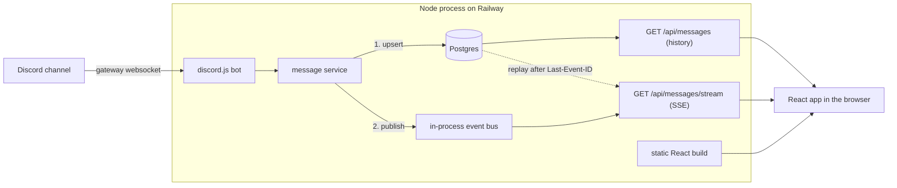

# Discord Live Stream

A Discord bot that mirrors one Discord channel into a web page in real time. Post a message in the channel and it appears on every open browser tab within about a second. Edits and deletes show up too.

**Stack:** TypeScript throughout. Node 22 + Fastify + discord.js on the back end, React + Vite on the front end, Prisma + PostgreSQL for storage, organised as a pnpm monorepo and deployed to Railway as a single service.

- Live deployment: https://appserver-production-9a7cc373.up.railway.app

---

## How it works



1. **Bot.** The server process logs in to the Discord gateway with the `Guilds`, `GuildMessages` and `MessageContent` intents. It listens for `messageCreate`, `messageUpdate`, `messageDelete` and `messageDeleteBulk`, and ignores everything outside the configured channel.
2. **Persist, then publish.** Each message is mapped to a small shared `ChatMessage` shape and upserted into Postgres, keyed by its Discord ID. Only after the write succeeds is it published on an in-process event bus. As a result, anything a browser sees live can also be reloaded or replayed from the database.
3. **History.** `GET /api/messages?limit=50&before=<id>` returns the most recent messages, oldest first. The "Load older messages" button uses `before` to page further back.
4. **Live stream.** `GET /api/messages/stream` is a Server-Sent Events endpoint. Each new message is sent with its Discord ID as the SSE event `id`.
5. **No gaps.** When the browser reconnects after a network blip, it automatically sends `Last-Event-ID`. The server replays everything newer than that ID from Postgres before switching to live events. The first connection passes `?lastEventId=` with the newest message from the history request, which covers anything posted between the page loading and the stream opening. The server subscribes to the bus _before_ running the replay query and buffers events in the meantime, so a message that arrives during the replay can't fall through the crack between the two.
6. **Catch-up after downtime.** When the bot connects, it fetches the channel's last 50 messages from Discord and upserts them. Upserts are idempotent, so messages it already has are harmless.
7. **One origin.** Fastify also serves the built React app, so there is no CORS and only one Railway service to run. `/api/health` reports database and Discord status and is the Railway healthcheck.

### Why Discord IDs are stored as `BIGINT`

Discord IDs ("snowflakes") are 64-bit integers that increase over time. Storing them as `BIGINT` primary keys means "newest first", "older than X" and "everything after X" are all plain integer comparisons on the index, with no separate timestamp column to keep in sync. They can't be strings in the database: `"99…9"` sorts after `"100…0"`, so ordering breaks whenever two IDs have different lengths. On the wire they stay strings, because they don't fit in a JavaScript `number`.

### Repository layout

```
apps/server     Fastify API, SSE, Discord bot, Prisma schema and migrations
apps/web        React app (Vite)
packages/shared ChatMessage schema (zod), SSE event names, shared types
```

---

## Alternatives considered

| Option                                                                                                | Why I didn't choose it                                                                                                                                                                                                                                                                                                                      |
| ----------------------------------------------------------------------------------------------------- | ------------------------------------------------------------------------------------------------------------------------------------------------------------------------------------------------------------------------------------------------------------------------------------------------------------------------------------------- |
| **WebSockets / Socket.IO** instead of SSE                                                             | Data only flows server → browser, so a two-way socket adds a protocol and a library for nothing. SSE is plain HTTP, gets through proxies, and the browser reconnects and sends `Last-Event-ID` on its own. That ID is what makes gap-free replay nearly free. I'd switch if the page ever needed to post back into Discord.                 |
| **Polling** `GET /api/messages?after=`                                                                | Simplest to build, but it trades latency against request volume. Polling every second for many viewers is wasteful, and anything slower no longer feels live.                                                                                                                                                                               |
| **Discord webhooks**                                                                                  | Discord webhooks only _send_ messages into a channel; they don't notify you when someone posts. Reading messages needs the gateway (a bot).                                                                                                                                                                                                 |
| **Bot as a separate worker service** sending events through Postgres `LISTEN/NOTIFY` or Redis pub/sub | This is the right shape at scale, because the web tier could then run many replicas. For one channel it means two services and a broker to deploy and debug, so I kept one process. The bus is a small interface (`apps/server/src/messages/bus.ts`), so a `LISTEN/NOTIFY` version could replace it without touching the routes or the bot. |
| **No database** (keep the last N messages in memory)                                                  | Fewer moving parts, but a restart loses history, replay after a reconnect only works within one process's lifetime, and messages posted while the server is down are gone. Postgres gives history, replay and recovery from one source of truth.                                                                                            |
| **Serverless functions** for the API                                                                  | SSE and a gateway connection are both long-lived, which serverless platforms handle poorly. A long-running container suits this better.                                                                                                                                                                                                     |

---

## Known problems and limitations

- **Exactly one instance.** The Discord connection and the event bus live inside the process. Two replicas would run two bots (double-ingesting, which is harmless thanks to upserts) with two separate buses, so a browser would only see events from the replica it happens to be connected to. `railway.json` pins `numReplicas: 1`. The fix is the separate-worker design above.
- **Catch-up after downtime is capped at 50 messages.** If more than 50 messages are posted while the server is down, the older ones are missed until someone pages back past them (and they aren't stored at all). Paging through the Discord API until reaching a known ID would fix this, at the cost of more rate-limit care.
- **Replay only covers new messages.** If the browser was disconnected while a message was edited or deleted, the reconnect replay won't include that change. Edit and delete events deliberately carry no SSE ID, so they can't move the resume cursor. A page reload shows the correct state. Fixing this needs a change log (a sequence number per change) instead of replaying by message ID.
- **Edits to messages older than our history are ignored**, and so are edits to messages from before the bot first ran, because they were never stored.
- **Message rendering is plain text.** Discord markdown, custom emoji, mentions (shown as `<@123…>`), embeds, stickers and replies aren't rendered. Text is never interpreted as HTML (React escapes it), so content can't inject markup. Images and files appear as attachments.
- **Attachment URLs expire.** Discord CDN links are signed and expire after about a day, so old images in history eventually stop loading. Re-signing them through the Discord API, or proxying them, would fix this.
- **It's public and read-only.** There's no authentication, and anyone with the URL can read the channel. Only point it at a channel whose contents you're happy to publish.
- **No rate limiting** on the HTTP endpoints, and no cap on concurrent SSE connections per client.
- **Bad configuration crashes on purpose.** An invalid token or a disabled Message Content intent stops the process with a one-line explanation. On Railway a failed deploy keeps the previous healthy one serving, which I prefer to a page that is up but silently empty.

---

## Running it locally

**Requirements:** Node ≥ 22.9, pnpm 9 (`corepack enable pnpm`), Docker.

### 1. Create the Discord bot

1. Go to the [Discord Developer Portal](https://discord.com/developers/applications), click **New Application**, then **Bot**, then **Reset Token**, and copy the token.
2. On the same Bot page, turn on **Message Content Intent** under _Privileged Gateway Intents_.
3. Go to **OAuth2** → **URL Generator**, tick the `bot` scope with the _View Channels_ and _Read Message History_ permissions, then open the generated URL and add the bot to your test server.
4. In Discord, enable **User Settings → Advanced → Developer Mode**, then right-click the channel and choose **Copy Channel ID**.

### 2. Run

```bash
pnpm install
docker compose up -d db                       # Postgres on localhost:5433
cp apps/server/.env.example apps/server/.env  # then fill in DISCORD_TOKEN and DISCORD_CHANNEL_ID
pnpm --filter @app/server exec prisma migrate dev   # optional: `pnpm dev` also applies pending migrations
pnpm dev                                      # API on :3000, web on http://localhost:5173
```

Post in the channel and watch it appear.

### Checks

```bash
pnpm lint && pnpm typecheck && pnpm test && pnpm build
```

The repository integration tests run against a separate `test` schema (`TEST_DATABASE_URL` in `.env`) and are skipped when it isn't set.

The test suite covers:

- **Server:** the mapper, service and bus; history and SSE routes over a real socket (replay, the replay/live race, heartbeat, disconnect cleanup, shutdown); static serving; and the Prisma repository against real Postgres.
- **Web:** the stream hook against a fake `EventSource` (dedupe, reconnect, retry, pagination) and the list component (escaping, auto-follow, scroll restoration).

---

## Deploying to Railway

1. Push this repository to GitHub.
2. In Railway, create a **New Project** → **Deploy from GitHub repo** and pick the repository. Railway reads `railway.json` and builds the `Dockerfile`.
3. In the same project, add **PostgreSQL** (**New** → **Database** → **PostgreSQL**).
4. In the app service's **Variables**, set:
   - `DATABASE_URL` = `${{Postgres.DATABASE_URL}}`
   - `DISCORD_TOKEN` = your bot token
   - `DISCORD_CHANNEL_ID` = the channel ID
5. Under **Settings** → **Networking**, click **Generate Domain**.

On each deploy the container runs `prisma migrate deploy`, then starts the server. Railway waits for `/api/health` to return 200 before switching traffic over. The server listens on Railway's `PORT`.
